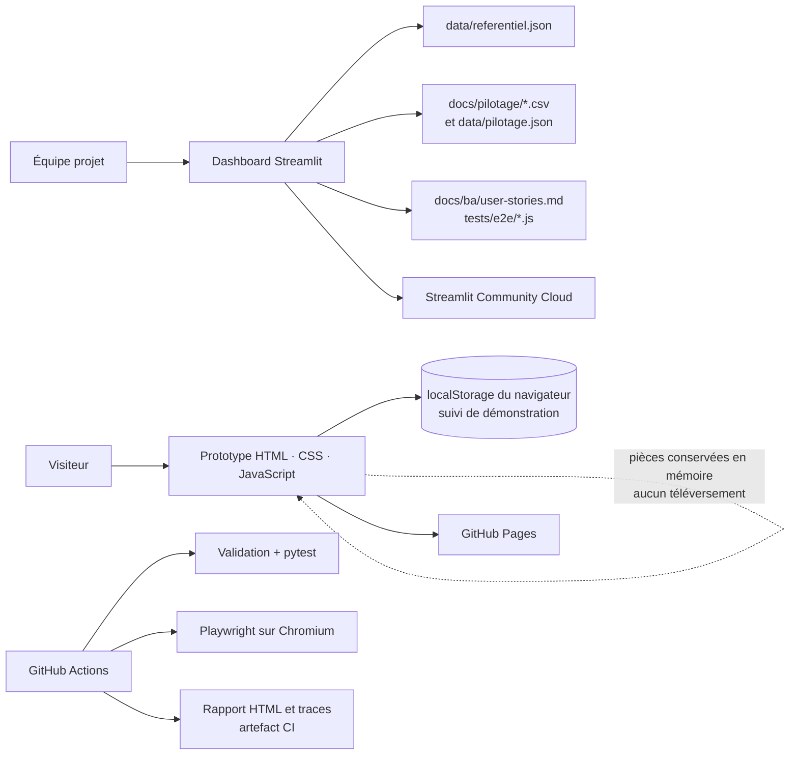

# Architecture de la démonstration

> Version documentaire : 1.0 · État : conforme au dépôt au 17 octobre 2026 · Cette architecture décrit un prototype de portfolio, pas un système d’assurance en production.

## Vue d’ensemble

Le dépôt contient deux applications indépendantes : un parcours de déclaration statique (`prototype/`) et un tableau de bord de pilotage/QA (`dashboard/`). Les deux utilisent le même référentiel fictif versionné dans Git. Il n’existe ni service métier, ni API, ni base de données.

## Composants et responsabilités

| Composant | Technologie | Responsabilité | Données persistées |
|---|---|---|---|
| Parcours | HTML, CSS, JavaScript sans framework | Formulaire en 5 étapes, validations, récapitulatif, confirmation fictive et suivi local | Référence et statut de démonstration dans `localStorage` seulement |
| Dashboard | Streamlit, pandas, Plotly | Pilotage fictif; lancement des contrôles Python; saisie manuelle de résultats; couverture US/TC | Les résultats saisis restent dans la session Streamlit; aucun stockage durable |
| Référentiel | JSON, Markdown, CSV | Source versionnée pour les exigences, tests, backlog, risques et données d’exemple | Git; données synthétiques uniquement |
| CI | GitHub Actions, pytest, Playwright | Validation documentaire, tests Python et parcours navigateur | Journaux et rapport HTML comme artefact CI à durée limitée |
| Publication | GitHub Pages et Streamlit Community Cloud | Héberger les deux démonstrations publiques | Déploiement depuis `main`; aucune donnée de déclaration n’est envoyée |

## Parcours de données

1. Le navigateur charge le prototype depuis GitHub Pages.
2. Les étapes du formulaire restent dans l’état JavaScript de la page. Les pièces ne sont ni lues côté serveur ni envoyées.
3. À la confirmation, une référence fictive et un statut sont enregistrés localement pour illustrer US-007/US-008. Ils peuvent être effacés avec les données du site.
4. Le dashboard lit les fichiers versionnés au démarrage. Les résultats QA saisis sont stockés dans `st.session_state` et disparaissent avec la session.
5. La CI lance les tests et dépose un rapport consultable dans l’artefact du workflow. Ce résultat n’est pas un historique permanent ni une mesure de couverture de code.

## Déploiement et environnements

| Environnement | Usage | Déclenchement | Limite connue |
|---|---|---|---|
| Poste local | Développement et revue | Serveur statique Python; Streamlit local si dépendances installées | Les résultats QA sont propres à la session locale |
| GitHub Actions | Contrôles automatisés | Push et pull request | Chromium Linux; aucun test sur appareils réels |
| GitHub Pages | Prototype public | Mise à jour de `prototype/` sur `main` | Site statique, sans service métier |
| Streamlit Community Cloud | Dashboard public | Synchronisation de `dashboard/app.py` sur `main` | Les résultats manuels ne sont ni partagés ni durables |

## Décisions et limites

- Le prototype demeure sans backend pour éviter de collecter de vraies déclarations ou pièces jointes.
- Les seuils métier, contrats, règles et données d’exemple sont fictifs; aucun chiffre ne constitue une règle d’assurance ou une promesse de service.
- Les chemins locaux, le stockage de session et les résultats QA ne constituent pas une architecture de production.
- Une future production exigerait une architecture approuvée : identité et autorisations, API, stockage chiffré, journalisation, règles métier versionnées, conservation, supervision, sauvegarde et reprise.

Voir aussi : [sécurité et données](securite-donnees.md), [ADR-001](decisions/ADR-001-prototype-local.md), [runbook](../runbook.md).
