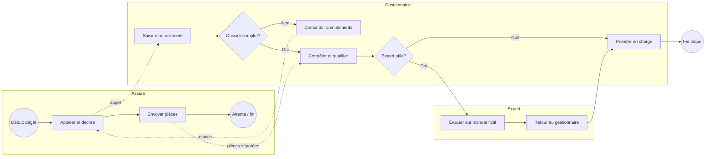

# Processus AS-IS

> Mermaid simplifié, pas une modélisation BPMN 2.0. Scénario fictif.

Les ressaisies, pièces séparées et relances peuvent allonger le parcours; aucun résultat réel n’est revendiqué.
