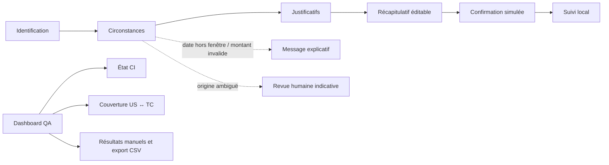
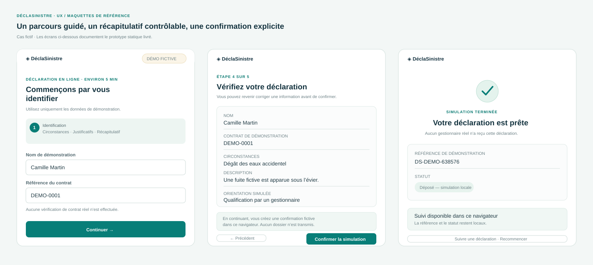
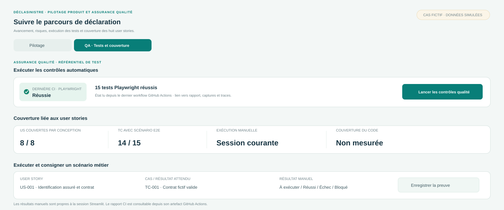

# Cahier UX — parcours de déclaration et pilotage QA

> Version 1.0 · Maquettes d’intention reliées au prototype livré · Données et profils entièrement fictifs.

## Objectif

Rendre la déclaration d’un dégât des eaux compréhensible, progressive et vérifiable, puis permettre à l’équipe projet de suivre la couverture des contrôles. Les maquettes documentent le comportement attendu; elles ne représentent pas une validation par un assureur ni un design system de marque.

## Profils et besoins

| Profil fictif | Besoin principal | Risque UX à traiter |
|---|---|---|
| Camille, assurée | Déclarer sans connaître le vocabulaire d’assurance; savoir ce qui est nécessaire | Abandon, champs incompris, crainte de perdre la saisie |
| Samir, gestionnaire | Recevoir des informations lisibles et repérer les dossiers à revoir | Une règle automatique pourrait être comprise comme une décision définitive |
| Équipe QA / produit | Relier les tests aux user stories et retrouver les preuves | Confondre couverture documentaire, couverture E2E et couverture de code |

## Principes d’expérience

1. **Progression explicite** : cinq étapes nommées, une action principale par écran, retour possible sans perdre les champs saisis.
2. **Langage concret** : labels toujours visibles, exemples fictifs annoncés, erreurs près de l’action à corriger.
3. **Décision humaine** : une origine incertaine conduit à une revue, jamais à un refus automatisé.
4. **Confiance** : les écrans précisent qu’aucun dossier n’est transmis et que la confirmation est une simulation locale.
5. **Contrôle de l’utilisateur** : le récapitulatif expose les informations avant confirmation; le suivi permet de retrouver le statut local de démonstration.
6. **Traçabilité QA** : la couverture de conception (US liées), les scénarios E2E et les exécutions manuelles ont des indicateurs distincts.

## Architecture de l’information

## Parcours et états

| Étape | Contenu | Action / réponse attendue | Tests de référence |
|---|---|---|---|
| Identification | Nom et contrat de démonstration | Vérifie le format fictif; une référence inconnue demande une revue humaine | TC-001, TC-002, TC-003 |
| Circonstances | Date, adresse, cause, estimation et description | Bloque les champs requis, dates futures/anciennes et montants hors limites illustratives | TC-004 à TC-006, TC-009 à TC-011 |
| Justificatifs | JPG, PNG ou PDF; limites par fichier et total | Refuse les formats ou tailles non acceptés; les pièces restent locales | TC-007, TC-008, TC-014 |
| Récapitulatif | Valeurs saisies, description, orientation indicative | Retour possible pour correction; aucune soumission avant confirmation | TC-012 (US-005) |
| Confirmation | Référence générée et mention de simulation | Enregistre un statut dans le navigateur seulement | TC-012 (US-006/007), TC-013 |
| Suivi | Référence et statut simulé | Retrouve la dernière déclaration de cette session; signale une référence inconnue | TC-013 |
| Dashboard QA | CI, exécutions, couverture et export | Distingue tests navigateur automatisés des exécutions manuelles | Test du workflow CI, vérification manuelle du dashboard |

## Maquettes

Les fichiers SVG sont vectoriels, modifiables et s’affichent dans GitHub sans logiciel de design propriétaire.

### Parcours de déclaration

### Dashboard de pilotage et QA

## Règles de contenu

- Employer « estimation indicative », « orientation simulée » et « revue humaine »; éviter toute promesse de garantie, d’indemnisation ou de délai réel.
- Afficher « démonstration fictive » et « aucune transmission » près des étapes de saisie et de confirmation.
- Les seuils 365 jours, 100 000 €, 5 000 €, 10 Mo et 30 Mo sont des valeurs de démonstration, jamais des règles universelles.
- Distinguer « scénario de test » d’« exécution réussie »; la présence d’un TC ne prouve pas qu’il a été exécuté.

## Accessibilité et responsive — critères de conception

- Cibles : navigation clavier complète, focus visible, labels associés aux champs, erreurs avec rôle d’alerte, étapes compréhensibles sans couleur seule.
- Le contenu doit se réordonner en une colonne sur petit écran; les boutons principaux restent visibles sans défilement horizontal.
- Les pièces doivent avoir des formats et limites indiqués avant sélection; les messages doivent expliquer comment corriger.
- La conformité WCAG n’est pas certifiée par ce projet. Avant toute mise en production, réaliser un audit avec lecteur d’écran, clavier seul et vérification des contrastes.

## Points à valider avant un vrai projet

1. Tests utilisateurs avec assurés et gestionnaires réels, sur terminaux mobiles.
2. Terminologie et règles métier validées par les responsables produit, juridique et indemnisation.
3. Critères d’accessibilité vérifiés par mesure, et non par intention documentaire seule.
4. Politique de reprise de saisie, d’authentification et de suivi confirmée par le métier.

## Liens de traçabilité

- Besoin et périmètre : [expression de besoin](../ba/expression-besoin.md).
- Règles et comportements : [règles de gestion](../ba/regles-gestion.md) et [user stories](../ba/user-stories.md).
- Vérification : [plan de test](../qa/plan-de-test.md), [cas de test](../qa/cas-de-test.md), [matrice](../qa/matrice-tracabilite.md).
- Écrans livrés : [prototype statique](../../prototype/index.html); le dashboard est disponible sur Streamlit.
